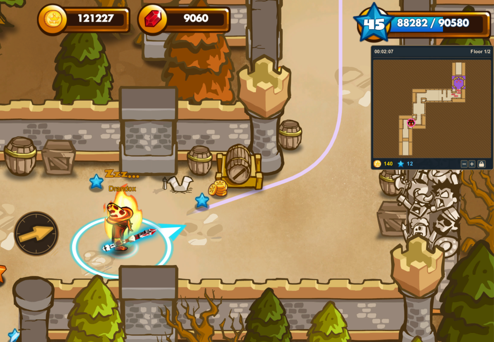

# Gate Compass

<!-- drh:show -->
Gate Compass helps you find the dungeon gate with compass directions and an optional path on the ground.

## Choose your guides

Turn each guide on or off independently. You can use any combination, including all three together.

- **2D Compass** - a flat golden compass you can drag and resize.
- **3D Compass** - a ground ring and direction triangle around your character. Its color adjusts to the dungeon theme to stay visible.
- **Pathfinder line** - a lavender route toward the gate, with rounded corners and fading ends.

Both compasses follow the same route as Pathfinder, even when the line is hidden. Guidance accounts for walls, permanent obstacles, and traps; breakable objects are ignored. Inside the exit room, it points toward the gate. In supported boss-only rooms, the 2D compass displays **Defeat the boss**.

## Make it yours

Open **MODS > Gate Compass > Settings**, or press **Ctrl + Shift + G**, to open the floating settings panel.

- Choose which guides to display.
- Adjust the ground circle size, arrow size, circle width, Pathfinder width, and arrow distance from the ring.
- Leave **Smooth Compass** on for quick, smooth turns of about **0.3 seconds**, or turn it off for instant direction changes.
- Adjust **Line length** from **300 to 2,200 world units** ahead along the route (default **2,200**).
- Use **Reset** to restore the defaults.

Drag the panel by its title bar. Hover over its bottom-right corner to reveal the resize handle. Your appearance settings, positions, and sizes save automatically.

Press **Ctrl + Shift + Q** to turn Gate Compass on or off. You can change this shortcut under **Compass Toggle** in the game's controls settings.

## Reduced Effects

**Recommended for lower-end devices; off by default.** This option reduces glow, removes the Pathfinder endpoint fade, and refreshes the visible path section less often while you move. Rounded ends remain, and routing and compass turning work the same way. The line still renders normally between visibility updates.

## Low power mode

Enable **Low power mode** for slower devices, especially with fast movement. It also enables the lighter visual treatment of Reduced Effects. Guidance updates about 30 times per second, tile changes trigger fresh targets, and fast movement bypasses the slower line-mask throttle. The compass animation and world position still follow the game render loop.

Low power mode skips extra room-anchor preparation, uses smaller cooperative search slices, and keeps refinement local. Normal mode prepares at most six rough alternatives in the current room, resuming that room if you return. Finished curved sections extend as local work completes, including while you move. Rounded corners are collision-checked incrementally and cached; unsafe corners retain their original shape. Normal mode uses eight curve samples per corner, and low-power mode uses four. This preserves weighted trap avoidance; it does not switch to an unvalidated room-center shortcut.

For less GPU work, shorten **Line length** or disable the ground compass while keeping the 2D compass. Wider lines cover more pixels but do not add path-search nodes. Avoid excessive width and glow on slower GPUs.

## While you play

The shared route field is prepared in short cooperative steps. The arrows can use a validated rough route immediately. The drawn line appears in finished curved sections, so it does not flash a jagged preview while refinement runs. Unfinished refinement stops when you leave its tile. Only a local route prefix is turned into line geometry, and it refreshes as you move. The guides and route preparation pause behind exit, revive, Settings, and results menus.

Turning off a guide releases its drawing resources while the others continue working. Turning all three off stops navigation work and clears its caches and graphics; the settings controls remain available. Leaving a match releases its navigation resources too.
<!-- /drh:show -->

## In-game previews

<table>
<tr>
<td width="50%" align="center"> <strong>With Effects</strong></td>
<td width="50%" align="center"> <strong>Reduced Effects</strong></td>
</tr>
</table>

### Settings

## Install

Use **DRH Launcher** to install Gate Compass when available in its mod catalogue, or download the ZIP from the [latest release](https://github.com/Drandoxy/DRH-Mod-Gate-Compass/releases/latest) and install it through the launcher.

Requires **Dungeon Rampage Haxe 18** and **Mod API 1.4 or later**, including API 1.5. Release history is available on the [Releases page](https://github.com/Drandoxy/DRH-Mod-Gate-Compass/releases).

Validated corners are cached by their coordinates, not only by the identity of a route array. Overlapping route sections reuse those results until geometry changes. This extra cache holds at most 128 corners normally, or 32 in low-power mode.

The line begins 135 world units ahead of the character. Replacement line meshes are prepared before the displayed meshes are released.
