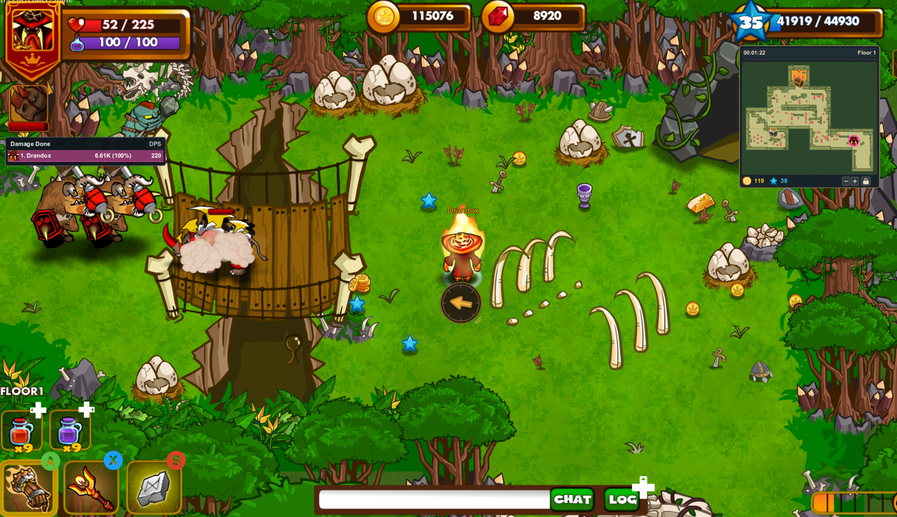

# Gate Compass

<!-- drh:show -->
Gate Compass helps you find the dungeon gate with compass directions and an optional path on the ground.

## Choose your guides

Turn each guide on or off independently. You can use any combination, including all three together.

- **2D Compass** — a flat golden compass you can drag and resize.
- **3D Compass** — a ground ring and direction triangle around your character. Its color adjusts to the dungeon theme to stay visible.
- **Pathfinder line** — a lavender route toward the gate, with rounded corners and fading ends.

Both compasses follow the same route as Pathfinder, even when the line is hidden. Guidance accounts for walls, permanent obstacles, and traps; breakable objects are ignored. Inside the exit room, it points toward the gate. In supported boss-only rooms, the 2D compass displays **Defeat the boss**.

## Make it yours

Click the **green settings gear beside chat** to open the floating settings panel.

- Choose which guides to display.
- Adjust the ground circle size, arrow size, circle width, Pathfinder width, and arrow distance from the ring.
- Leave **Smooth Compass** on for quick, smooth turns of about **0.3 seconds**, or turn it off for instant direction changes.
- Use **Reset** to restore the defaults.

Hold the gear for **0.5 seconds**, then drag to move it. Drag the panel by its title bar. Hover over the bottom-right corner of the gear or panel to reveal its resize handle. Your appearance settings, positions, and sizes save automatically.

Press **Ctrl + Shift + Q** to turn Gate Compass on or off. You can change this shortcut under **Compass Toggle** in the game's controls settings.

## Reduced Effects

**Recommended for lower-end devices; off by default.** This option reduces glow, removes the Pathfinder endpoint fade, and refreshes the visible path section less often while you move. Rounded ends remain, and routing and compass turning work the same way. The line still renders normally between visibility updates.

## While you play

Routes are prepared in the background when a match starts, with guidance near your starting position prioritized. The guides hide during the game's Settings menu, exit confirmation, and results screens.

Turning off a guide releases its drawing resources while the others continue working. Turning all three off stops navigation work and clears its caches and graphics; the settings controls remain available. Leaving a match releases its navigation resources too.
<!-- /drh:show -->

## 2D Compass

<table>
<tr>
<td width="70%" align="center"> 2D Compass</td>
<td width="30%" align="center"> 2D Compass — boss objective</td>
</tr>
</table>

## Install

Use **DRH Launcher** to install Gate Compass when available in its mod catalogue, or download the ZIP from the [latest release](https://github.com/Drandoxy/DRH-Mod-Gate-Compass/releases/latest) and install it through the launcher.

Requires **Dungeon Rampage Haxe 18** and **Mod API 1.4 or later**, including API 1.5. Release history is available on the [Releases page](https://github.com/Drandoxy/DRH-Mod-Gate-Compass/releases).
