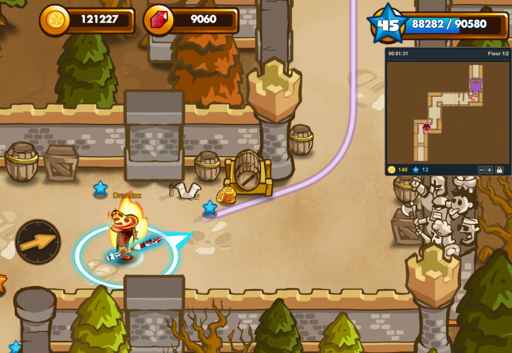
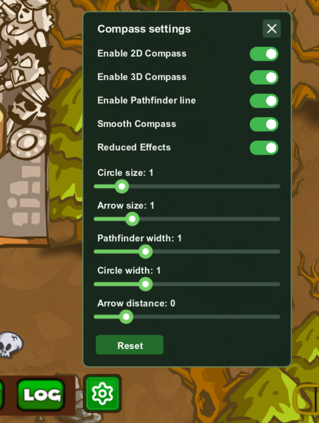

# Gate Compass

<!-- drh:show -->
Gate Compass points toward the dungeon gate with optional 2D, ground and Pathfinder guides.

## Guides

- **2D Compass**: a golden compass you can drag and resize.
- **3D Compass**: a ground ring and direction triangle, coloured for the dungeon theme.
- **Pathfinder**: a lavender path with collision-checked curves and fading ends.

Enable each independently. Both compasses sample the route 15 world units ahead of your hero, even when the line is hidden. Guidance accounts for walls, permanent obstacles and traps, while ignoring breakable props. Supported boss-only rooms show **Defeat the boss**.

## Settings

Open **MODS > Gate Compass > Settings**, or press **Ctrl + Shift + G**.

- Adjust circle/arrow sizes, stroke widths and arrow distance.
- **Line length**: 300–2,200 world units; default 2,200.
- **Line start distance**: 0–500 world units from your hero; default 135. It is capped below line length so a section remains visible. This does not change the compass's hidden 15-unit direction average.
- **Routes per tile**: 10–81 cached alternatives; default 36. Fewer alternatives reduce background preparation and memory. This is different from how many paths are drawn simultaneously.
- **Smooth Compass** gives smooth turns; turn it off for immediate direction changes.
- **Reset** restores defaults. Settings, positions and sizes save automatically.

Move the settings panel by its title bar; its bottom-right corner resizes it. **Ctrl + Shift + Q** toggles navigation and releases its caches when off.

## Capacity test

Click **Test capacity** in a dungeon. Confirm the instructions, then stand still in a safe place on the map you want to test.

The countdown runs for **8 seconds from the first test line's calculation**, after any wait for map data. Temporary paths increase through **1, 4, 8, 16 and 32 additional lines** around your hero. The test compares frame times with its baseline. Moving, opening a menu, leaving, Cancel or repeated very slow frames stops the test and removes its graphics.

Results show a provisional route-count recommendation and the drawing-load result separately. **Yes** applies the recommended route count; **No** keeps your settings. A warm cache may provide too few new route samples, in which case your current count is retained. This is a workload estimate for this map, not a hardware rating or a guarantee for every floor.

## Lower-power options

**Reduced Effects** reduces glow, removes endpoint fading and updates the visible path section less often. **Low power mode** also uses smaller work budgets/caches and updates guidance around 30 times per second. Both retain the original 12-sample curves. Shorter or narrower lines reduce drawing work; width does not increase path-search nodes.

Geometry and route work resume in short steps. Completed routes are cached across room changes, and only a nearby section becomes drawing geometry. A valid line stays until its replacement is ready. Navigation pauses behind game menus and releases its resources when all guides are off or you leave.
<!-- /drh:show -->

## In-game previews

<table>
<tr>
<td width="50%" align="center"> <strong>With Effects</strong></td>
<td width="50%" align="center"> <strong>Reduced Effects</strong></td>
</tr>
</table>

### Settings

## Install

Use **DRH Launcher** to install Gate Compass when available in its mod catalogue, or download the ZIP from the [latest release](https://github.com/Drandoxy/DRH-Mod-Gate-Compass/releases/latest) and install it through the launcher.

Requires **Dungeon Rampage Haxe 18** and **Mod API 1.4 or later**, including API 1.5. Release history is available on the [Releases page](https://github.com/Drandoxy/DRH-Mod-Gate-Compass/releases).

Completed full routes are cached until the geometry or destination changes. Normal mode retains at most 120,000 route points, and low power mode at most 30,000, with at most eight tiles' worth of entries. Returning to a cached route reuses its curve geometry.

The line starts at the selected distance (135 units by default), independently of the 15-unit hidden compass average. Replacement line meshes are prepared before the displayed meshes are released.

## Local diagnostics

Capacity tests run only after pressing **Test capacity** and confirming. No automatic per-floor test runs, including on development installations with an older `autoProfile` preference. Optional local diagnostics (`{"enabled":true}` in `local-diagnostics.json`) record only explicitly started tests; no data is uploaded.

Offline regression checks are described in [tests/README.md](tests/README.md). Native game compilation, graphics and device performance require an in-game test.

## Calculation details

Both modes retain the original collision-checked, 12-sample rounded corners. Route extraction, visibility tests and curve validation resume across short slices instead of completing an entire route in one update. Completed routes stay cached as you cross rooms. Alternative preparation focuses on the current room, up to your selected route count; least-recently-used entries are evicted under a bounded cache. Low power mode uses a smaller work budget and point cache.

These are cooperative budgets, not a hard CPU limit: an individual native collision query can exceed its time slice. The capacity estimate is provisional, not a hardware benchmark or guarantee of frame rate.

A mostly completed cache may provide too few new routes for a recommendation; try a fresh floor.

Startup first scans nearby gate approaches and uses a fixed Manhattan heuristic toward the initial hero position, then finishes the shared field. Missing edge answers needed by the first curved route are checked on demand and cached, so line validation need not wait for the entire field. A full gate-approach scan remains available if local approaches cannot reach the hero. Diagnostics distinguish initial-search delay, first mesh time, geometry updates and mesh construction.

The first line now prepares a bounded 2,800-unit section with the same 12-sample, collision-checked curve algorithm before processing the full route. Foreground work has priority over optional field completion within the existing per-update budget. Initial search can use the full budget while no foreground route is ready. Diagnostics record the first compass direction separately from the first mesh.

## Geometry and calibration updates

Collision snapshotting, signature comparison, grid initialization, shape rasterization and clearance propagation are resumable. A completed grid is published atomically; unchanged geometry reuses the previous grid. Clearance propagation visits walkable cells instead of flooding empty areas. Destination-field arrays are initialized incrementally too.

Theme tinting uses a native bitmap colour matrix matching the previous cyan/white pigment formula, rather than Haxe pixel loops. Reduced-effects alpha cutoff uses a bitmap threshold operation. The old broad geometry timer also included theme-artwork generation, so previous peak timings were not exclusively grid costs.

Calibration now examines recurring slice tails and average per-frame mod work, excluding separately measured geometry/mesh preparation. It preserves a compatible selected cache count rather than interpreting full-route preparation time as a per-frame limit. Manual tests start on their first actual route-job step, and only an explicitly confirmed manual test creates stress-test graphics. Automatic per-floor profiling has been removed. Drawing records include phase counts, baseline/phase mean and 95th-percentile frame times, sample counts and cancellation information.

Compass direction averages the next15 world units of route, reducing short-segment jitter. A rejected candidate cannot change the heading of the still-active route. Sharp turns are included in local diagnostics for further native investigation.
